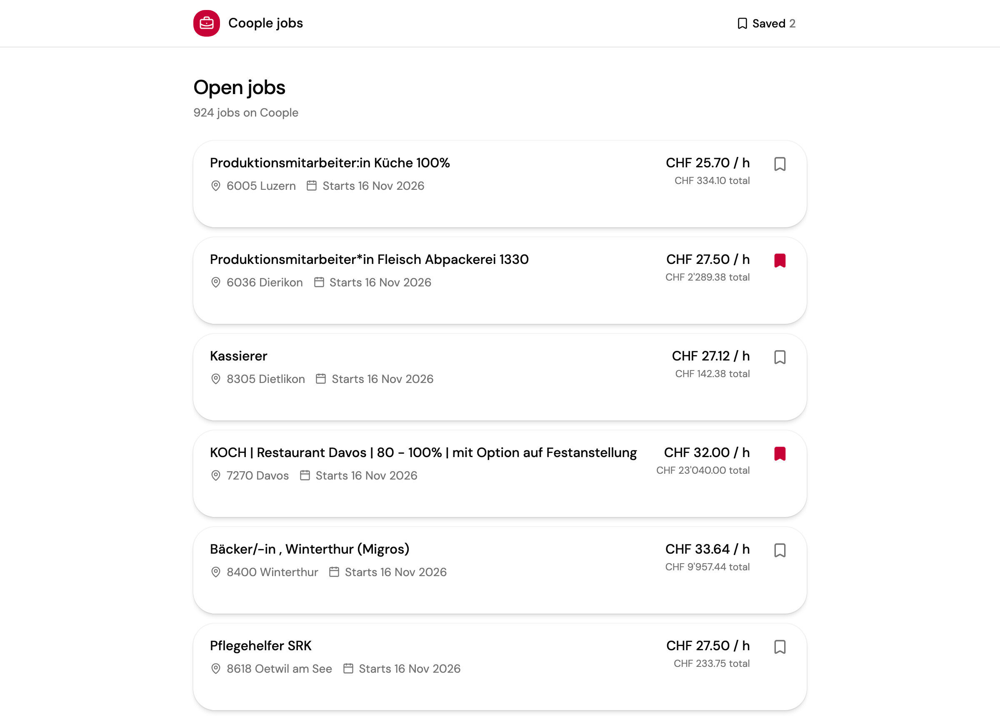
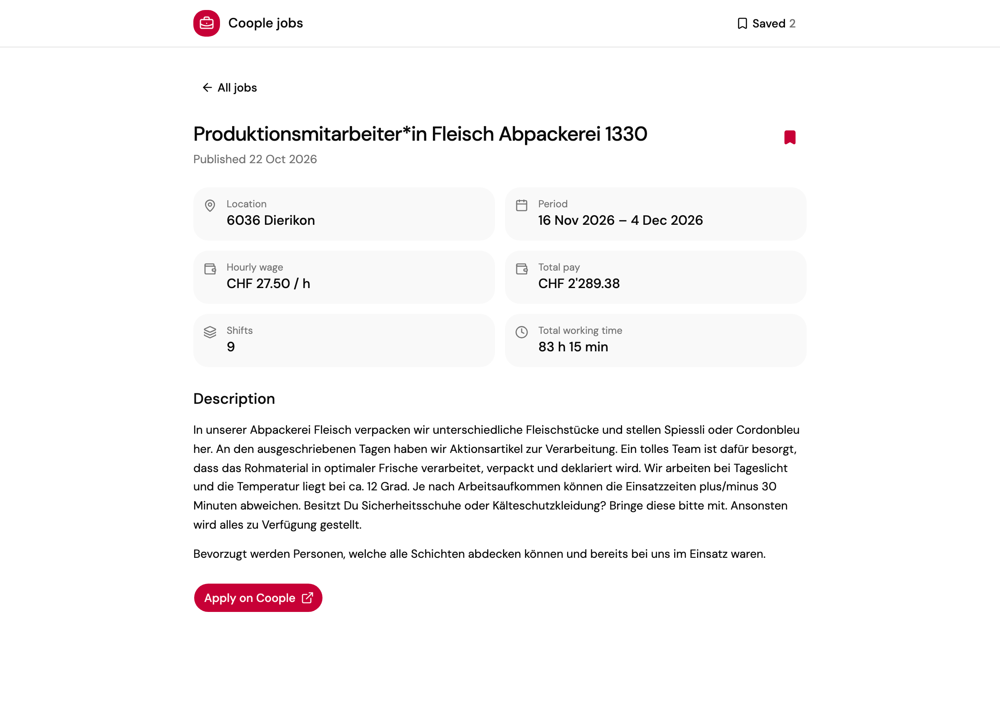
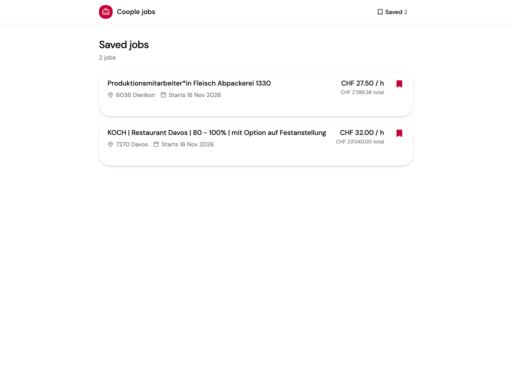
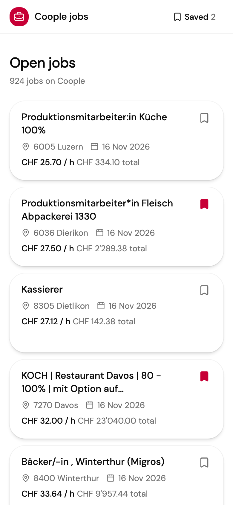

# Coople jobs

**Live demo: https://jobs-board-one.vercel.app**

A small web app over Coople's public jobs API:

- **Job list** at `/` with infinite scroll
- **Job details** at `/job/:id`, which also opens directly from a link
- **Favourites**: mark or unmark a job on either screen, kept across reloads, and listed at `/favourites`

| Job list                                | Job details                                   | Saved jobs                                |
| --------------------------------------- | --------------------------------------------- | ----------------------------------------- |
|  |  |  |

| Phone                                      |
| ------------------------------------------ |
|  |

## Setup

Requires Node 22.22 or newer and pnpm. The pnpm version is pinned in `package.json`; `corepack enable` installs it.

```bash
corepack enable
pnpm install
pnpm dev
```

Open http://localhost:5173.

| Command                          | What it does                                 |
| -------------------------------- | -------------------------------------------- |
| `pnpm dev`                       | Dev server with the API proxy                |
| `pnpm build` then `pnpm preview` | Production build, served with the same proxy |
| `pnpm test`                      | Unit and integration tests                   |
| `pnpm e2e`                       | Browser tests with Playwright, API mocked    |
| `pnpm check`                     | Typecheck, Biome lint and format, unit tests |

The first `pnpm e2e` run needs a browser: `pnpm exec playwright install chromium`.

Environment variables are optional, defaults are in `.env.example`.

**Deploy.** `vercel.json` mirrors the Vite proxy with a rewrite and sends every other path to `index.html`, so `/job/:id` opens directly. No environment variables are needed. CI (GitHub Actions) runs `pnpm check` and `pnpm e2e` on pushes to `main` and on pull requests.

## Architecture

```
routes  →  components  →  components/ui
   ↓
queries  →  api  →  entities
stores
```

| Folder           | Role                                                                                                                          |
| ---------------- | ----------------------------------------------------------------------------------------------------------------------------- |
| `src/routes`     | Pages. Read route params, call hooks, choose the screen state (loading, error, empty, not found, data) and compose components |
| `src/components` | All UI. Components render the props they get; the favourite button is the one exception and reads its own tiny store          |
| `src/queries`    | Server state: TanStack Query options and hooks for jobs                                                                       |
| `src/stores`     | Client state owned by the browser: the favourites zustand store                                                               |
| `src/hooks`      | Generic hooks that know nothing about jobs: loading more on scroll                                                            |
| `src/api`        | Talking to Coople: HTTP client, the Coople response wrapper, schemas of Coople's responses, endpoints                         |
| `src/entities`   | The domain model: schemas that validate a Coople response and transform it into our types, which are inferred from them       |
| `src/lib`        | Pure functions: formatting                                                                                                    |

There is one domain (jobs), so the code is grouped by role rather than by feature. Something used by a single component lives next to it (`components/job-card/`) and moves to a shared folder once a second user appears. Biome (lint and format) enforces the main boundaries: no `fetch` outside the API client, no API imports from components.

### Request flow for `/job/:id`

1. The route loader validates the id as a UUID. A malformed id renders 404 without calling the API.
2. The loader starts prefetching the job into the TanStack Query cache, so the request begins before the page renders.
3. `apiClient.get` calls `/api/...`, which Vite proxies to coople.com, and unwraps the Coople response into data or a typed `ApiError` (`not_found`, `network`, `server`, `invalid_response`).
4. The entity schema validates the payload against Coople's shape and transforms it into the domain model in the same step (`workAssignmentName` → `title`, timestamps → `Date`).
5. The query client retries network errors, 5xx, 408 and 429. The page renders loading, not found, error with retry, or the job.

## Decisions

Why the app is built this way, what the live API showed, and the known gaps and next steps are in [DECISIONS.md](DECISIONS.md).

## Beyond the brief

The task asked for about an hour of work. I also added: infinite scroll instead of a single page, runtime validation, a typed error model, accessible states (`aria-pressed`, status regions, skeletons), tests and an agent setup (`CLAUDE.md`).

## Tests

Both suites run on real API responses saved in `src/test/fixtures`, so they don't depend on the live API.

**Unit and integration** (Vitest, Testing Library, MSW), 46 tests:

- API client: error responses with HTTP 200, 404, 5xx, network failure, responses without the Coople wrapper, which errors are retried
- Endpoints and mapping, pagination end detection, strict and lenient validation, dates in Swiss time
- Favourites store: toggling, persistence, corrupted storage
- Pages: list, empty state, error and retry on both screens, a failed next page that keeps loaded jobs, direct link to a job, malformed id without an API call, unknown job, saved jobs with an empty state and a job that is no longer available

**Browser** (Playwright, API mocked with `page.route`), 18 tests:

- Infinite scroll, a failed next page with retry, scroll position restored after coming back from a job
- Direct links, not found for malformed and unknown ids, favourites across the list, details, the saved page and a reload
- Layout at 375, 1024 and 1440 px: equal card heights, no horizontal scroll, the skeleton matches the card, pay and bookmark align with the title
